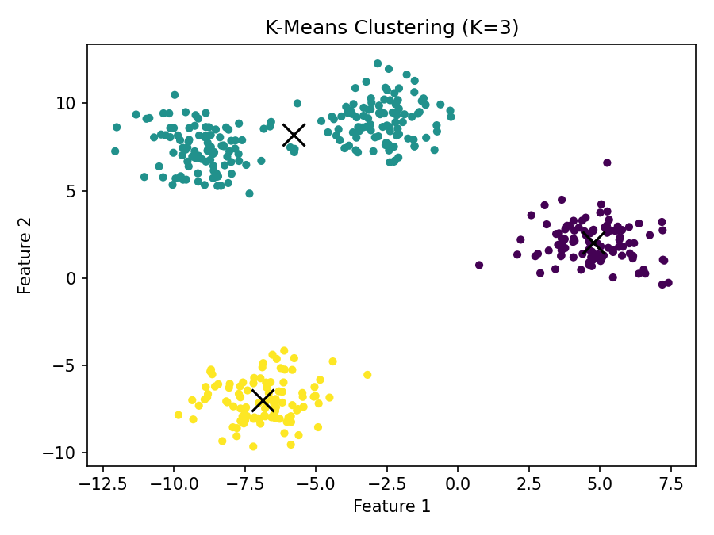
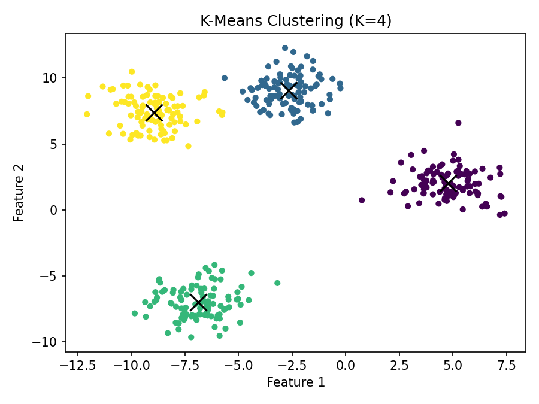
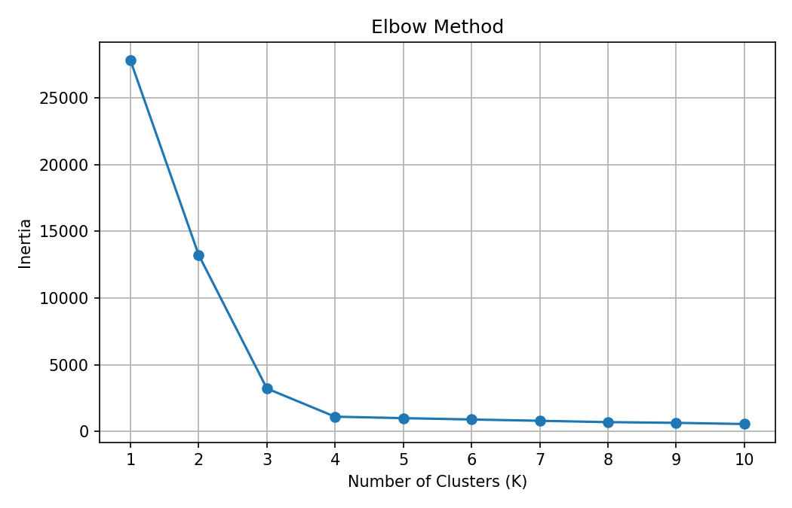
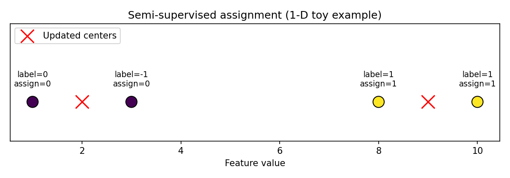

# open-world-category-discovery

## Objective

Practise K-Means on synthetic data: unsupervised clustering, choosing K with the elbow method, and a semi-supervised variant where known labels constrain the assignment step.

## Method

**1. Unsupervised K-Means**

- Generate **400 points** with `make_blobs` (4 true centers, `cluster_std=1.2`, `random_state=42`), stored in `X_blobs`.
- Fit K-Means with **K = 3** and **K = 4** (`n_init=10`, `random_state=42`).
- Compare the models with **inertia** (within-cluster sum of squared distances).

**2. Elbow Method**

- Fit K-Means with **K = 1 … 10** on the same `X_blobs`.
- Plot inertia against K and look for the elbow.

**3. Semi-supervised K-Means**

- 1-D toy data `X_toy = [1, 8, 10, 3]`, initial centers `[1, 9]`.
- Known labels `[0, 1, 1, -1]`, where `0` = cat, `1` = dog and `-1` = unknown.
- Assign every point to its nearest center, then overwrite the assignments of labeled points using a NumPy boolean mask.
- Update the centers from the constrained assignments.

## Results

### Unsupervised K-Means

| K | Inertia |
|---|---------|
| 3 | **3218.6614** |
| 4 | **1103.7864** |

**K = 3**



**K = 4**



### Elbow Method

| K | Inertia |
|---|---------|
| 1 | 27811.1843 |
| 2 | 13234.2929 |
| 3 | 3218.6614 |
| 4 | **1103.7864** |
| 5 | 995.4031 |
| 6 | 894.9240 |
| 7 | 796.8036 |
| 8 | 697.3256 |
| 9 | 643.4921 |
| 10 | 554.3528 |



### Semi-supervised K-Means

| x | label | status | ordinary assignment | final assignment |
|---|-------|--------|---------------------|------------------|
| 1 | 0 | labeled | 0 | 0 |
| 8 | 1 | labeled | 1 | 1 |
| 10 | 1 | labeled | 1 | 1 |
| 3 | -1 | unlabeled | 0 | 0 |

Updated centers: **[2, 9]**



## Observation

**Unsupervised clustering.** K=3 has a much larger inertia (3218.66) than K=4 (1103.79). Inertia is the sum of squared distances between each point and its assigned centroid, and adding a centroid can only keep this sum the same or reduce it. The data were generated from four clusters, so K=3 has to merge two of them and leaves large within-cluster distances. K=4 matches the true structure much better. A lower inertia is not automatically a better model, because inertia generally decreases as K grows.

**Elbow.** Inertia falls sharply from K=1 to K=4 and then flattens. The elbow is around **K=4**, which agrees with the four true clusters. This shows how the marginal improvement in inertia can be used to estimate a reasonable K.

**Semi-supervised assignment.** The key code is:

```python
known = labels != -1
assignments[known] = labels[known]
```

`known` is a boolean mask, and `assignments[known]` selects only the labeled positions. Labeled points therefore keep their given labels even if a center is closer, while unlabeled points are assigned by distance. In this toy example the known labels happen to agree with the nearest-center assignments, so the final assignments equal the ordinary ones; the constraint would override the distance-based result whenever a known label disagreed. After the update, the centers move from `[1, 9]` to `[2, 9]`.

## Repository structure

```
open-world-category-discovery/
├── README.md
├── requirements.txt
└── experiments/
    ├── day01_kmeans.ipynb
    └── figures/
        ├── kmeans_k3.png
        ├── kmeans_k4.png
        ├── elbow_method.png
        └── semi_supervised_toy.png
```
